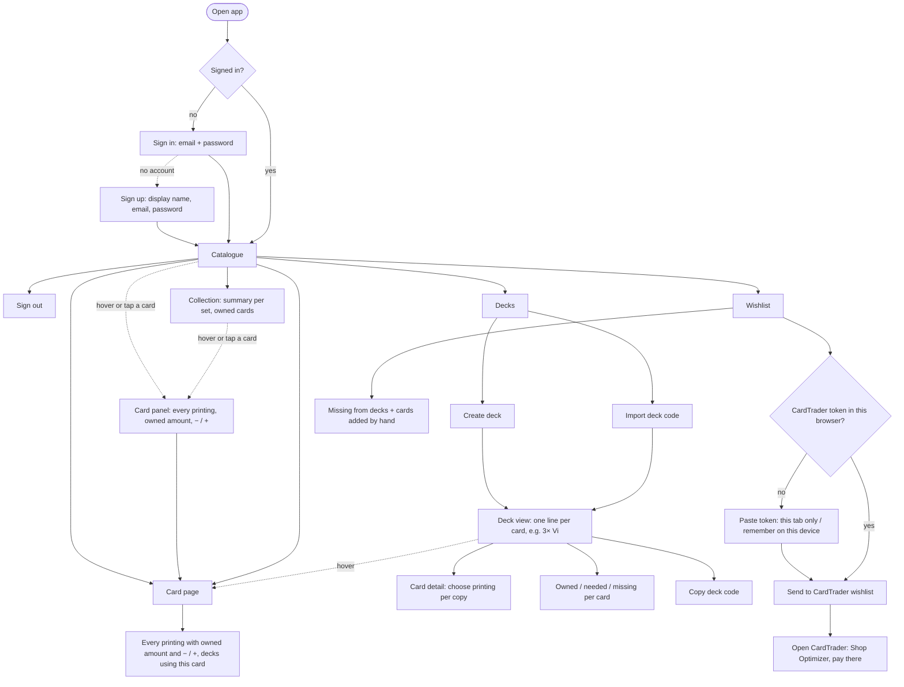

# User flows (MVP)

What a player can do in the first version.

## In the MVP

- A public home page at `/` explains the app; everything else is behind sign-in (email and password accounts with a display name)
- Card catalogue: browse and search every printing
- Collection: owned printings with quantities, changed from the card page or the card panel (hover or tap any card). The Cards page (`/cards`) is both the catalogue and the collection: a switch shows All cards, My collection (with a summary per set) or Wanted (what decks miss plus the custom wishlist); each card shows how many you own and how many you need
- The catalogue, the collection and decks show one entry per card; every printing of a card is in its panel and page
- Decks: create, duplicate, delete, import and export Piltover Archive deck codes. The deck page checks the official deckbuilding rules as you build (progress per part, problems explained), shows one tile per version with capped Main / Side counters, and has deck stats and card search side by side (a bottom sheet on phones)
- Missing cards: what all decks need combined, minus what you own
- Card page and hover: owned printings and the decks that use the card
- Wishlists: one per deck (what it misses, kept up to date) plus a custom one for cards added by hand. Marking cards as bought adds them to the collection. With the user's own CardTrader token, a wishlist can be created on CardTrader and synced by hand, and a CardTrader wishlist can be imported into the custom one

## Later

- Collection CSV import/export (Piltover Archive format)
- Prices
- Foil, language and condition on owned copies
- Public deck links
- Discord sign-in and account linking
- Email verification and password reset
