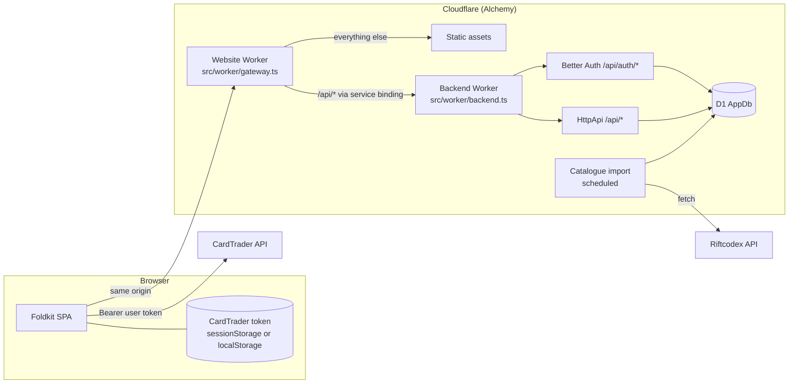

# System design (MVP)

## Components

| Component        | Where                    | Does                                                                                  |
| ---------------- | ------------------------ | ------------------------------------------------------------------------------------- |
| Foldkit SPA      | `src/` (client code)     | The whole UI. Talks only to its own origin and, with the user's token, to CardTrader. |
| Website Worker   | `src/worker/gateway.ts`  | Serves the static assets and forwards `/api` and `/api/*` to the Backend.             |
| Backend Worker   | `src/worker/backend.ts`  | Private (no public URL). Runs Better Auth and the `HttpApi`.                          |
| API contract     | `src/api/`               | `HttpApi` definition shared by the Backend and the browser's `ApiClient`.             |
| Catalogue import | Backend, scheduled       | Fetches Riftcodex, checks the data, replaces the `printing` table all or nothing.     |
| AppDb            | D1, `src/worker/schema/` | One database for Better Auth's tables and the app's tables. Drizzle defines both.     |

## What lives where

| Data                                         | Where               | Reaches our server? |
| -------------------------------------------- | ------------------- | ------------------- |
| Account (display name, email, password hash) | D1 (Better Auth)    | yes                 |
| Session                                      | D1 + cookie         | yes                 |
| Card catalogue                               | D1 `printing`       | yes                 |
| Collection, decks, wishlist                  | D1                  | yes                 |
| CardTrader token                             | user's browser only | **never**           |

## Why

- **Gateway plus private Backend:** Alchemy's full-stack example pattern. The browser only talks to its own origin, so session cookies work and there is no CORS.
- **Catalogue in our database:** the source is parsed and corrected once on the server, every printing has a stable id that collections and decks can reference with foreign keys, and the app does not depend on Riftcodex being up.
- **CardTrader from the browser:** its API allows calls from any site (`access-control-allow-origin: *`, `authorization` allowed), so the user's token never passes through our Workers.
- **One database:** Better Auth's tables live next to ours, so foreign keys and cascades work (deleting an account deletes its data).

## Secrets

None to manage by hand. Better Auth's signing secret is generated and kept by Alchemy (`Alchemy.Random`).
