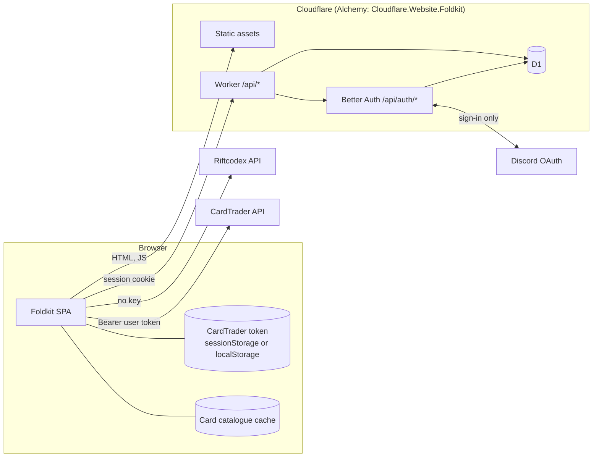

# System design (MVP)

## What lives where

| Data | Where | Reaches our server? |
|---|---|---|
| User identity (Discord id, name, avatar) | D1 | yes |
| Collection, decks, wishlist | D1 | yes |
| Discord OAuth tokens | not kept (see open questions) | only during sign-in |
| CardTrader token | user's browser only | **never** |
| Card catalogue | Riftcodex, cached in browser | no |

## Why

- **CardTrader called from the browser:** the API allows calls from any site (`access-control-allow-origin: *`, `authorization` allowed). So the token never passes through the Worker.
- **Riftcodex called from the browser:** it allows calls from any site too, needs no key, and the server needs no secret.
- **Better Auth:** it isn't tied to one provider. Discord is the first one, and others can be added later.
- **Only our data in the Worker:** the Worker serves sign-in plus the user's collection, decks and wishlist. Unknown `/api` paths return 404 (existing behaviour in `src/worker.ts`).

## Secrets

Only these Worker secrets: the Better Auth secret, the Discord client id and the Discord client secret.
