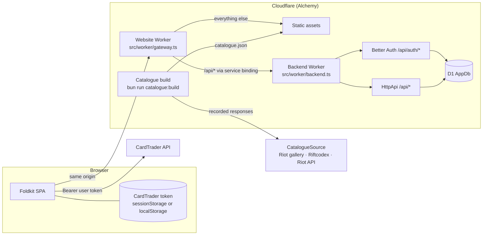

# System design (MVP)

## Components

| Component       | Where                    | Does                                                                                                                                      |
| --------------- | ------------------------ | ----------------------------------------------------------------------------------------------------------------------------------------- |
| Foldkit SPA     | `src/` (client code)     | The whole UI. Talks only to its own origin and, with the user's token, to CardTrader.                                                     |
| Website Worker  | `src/worker/gateway.ts`  | Serves the static assets and forwards `/api` and `/api/*` to the Backend.                                                                 |
| Backend Worker  | `src/worker/backend.ts`  | Private (no public URL). Runs Better Auth and the `HttpApi`.                                                                              |
| API contract    | `src/api/`               | `HttpApi` definition shared by the Backend and the browser's `ApiClient`.                                                                 |
| Catalogue build | `scripts/catalogue/`     | Reads a `CatalogueSource`, checks the data, writes `catalogue/catalogue.json` (git-ignored; CI builds it from the recordings kept in R2). |
| AppDb           | D1, `src/worker/schema/` | One database for Better Auth's tables and the app's tables. Drizzle defines both.                                                         |

## What lives where

| Data                                         | Where                                                      | Reaches our server? |
| -------------------------------------------- | ---------------------------------------------------------- | ------------------- |
| Account (display name, email, password hash) | D1 (Better Auth)                                           | yes                 |
| Session                                      | D1 + cookie                                                | yes                 |
| Card catalogue                               | static `catalogue.json` (browser) + bundled in the Backend | yes (static asset)  |
| Collection, decks, wishlist                  | D1                                                         | yes                 |
| CardTrader token                             | user's browser only                                        | **never**           |

## Why

- **Gateway plus private Backend:** Alchemy's full-stack example pattern. The browser only talks to its own origin, so session cookies work and there is no CORS.
- **Catalogue as a static file:** it is the same for every user and changes only when we rebuild it. The browser downloads it once (about 170 KB compressed), searches it locally with Orama and caches it forever (hashed file name); static assets are free and unlimited, so browsing costs no D1 reads and no Worker CPU. The Backend imports the same file to check printing ids.
- **Free plan only:** the Workers Free plan has hard caps (requests fail, nothing is billed). The design keeps every user action to a handful of small requests.
- **Swappable card sources:** a public app may only use Riot's official API ([policy](https://developer.riotgames.com/policies/riftbound)), which our key cannot reach yet. Until then the same `CatalogueSource` service is implemented by recorded responses from Riot's gallery feed (and later Riftcodex), for development only.
- **CardTrader from the browser:** its API allows calls from any site (`access-control-allow-origin: *`, `authorization` allowed), so the user's token never passes through our Workers.
- **One database:** Better Auth's tables live next to ours, so foreign keys and cascades work (deleting an account deletes its data).

## Secrets

- `RIOT_API_KEY`: the Riot Developer Portal key, used only by the official-API `CatalogueSource` layer once a key has access.
- Better Auth's signing secret is generated and kept by Alchemy (`Alchemy.Random`).
- `INVITE_CODE`: the code sign-up needs while the app is invite only. Read by the Backend at startup, so Alchemy binds it as a Worker secret; locally from `.env`, in CI from the repository secret.
- Card data: not a secret, but never committed. Packed recordings live in the private R2 bucket `cardtrader-data` (declared in `alchemy.run.ts`, shared by every stage); CI downloads them with `CLOUDFLARE_API_TOKEN`.
