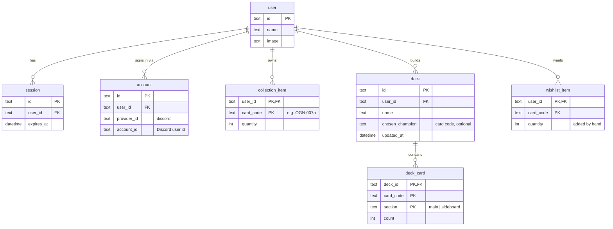
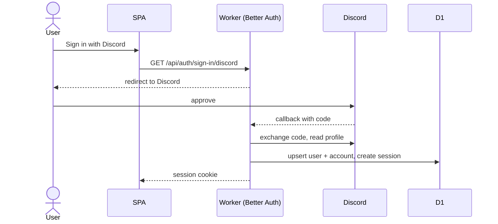
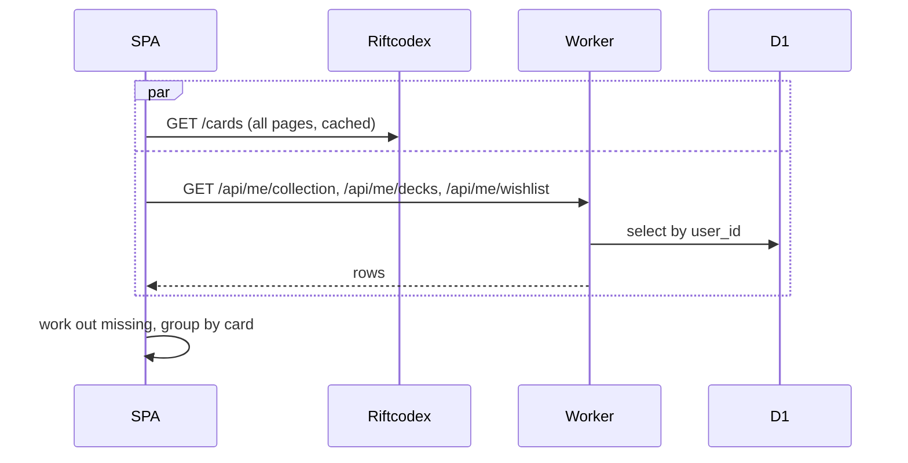
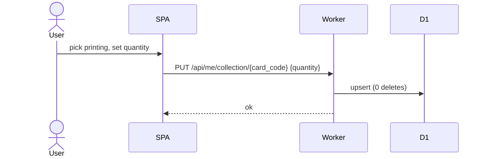
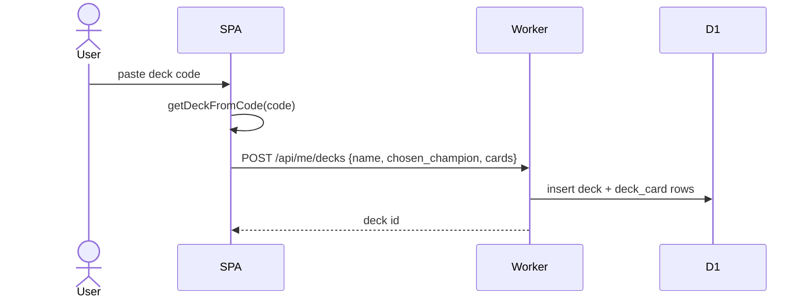
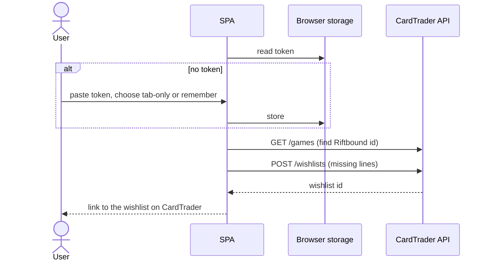

# Data and flows (MVP)

## Card identity

A card printing is identified by its **card code**, the format used by
[Piltover Archive deck codes](https://github.com/Piltover-Archive/RiftboundDeckCodes):

```
OGN-007a   set OGN, number 007, variant a (alternate art)
OGN-007s   signed (also written OGN-007*)
OGS-R01    rune
VEN-SP1    special
```

Riftcodex `riftbound_id` values look like `ogn-007a-298`. The card code is the
first two parts in upper case (`OGN-007a`).

## Data model (D1)



- `user`, `session` and `account` belong to Better Auth. Their exact columns come from its schema; only the relevant ones are shown.
- `deck_card` rows have the same shape as the deck-code library's `{ cardCode, count }`, so import and export convert directly.
- "Missing" is calculated, not stored.

## Missing cards

For each card code:

```
needed  = sum of deck_card.count across all of the user's decks
missing = max(0, needed - collection_item.quantity)
wishlist line = missing + wishlist_item.quantity
```

The deck view groups lines by card (same name across printings) for display.
Each line stays a specific printing.

## Flows

### Sign in



### Load the app



### Add an owned card



### Import a deck code



### Send wishlist to CardTrader



## Open questions (the MVP answers these with a real token)

1. The body CardTrader expects for `POST /wishlists`: card codes (`expansion_code` + `collector_number`), or its own blueprint ids.
2. Whether CardTrader's Riftbound expansion codes match `OGN`, `UNL`, …
3. How CardTrader numbers alt-art and signed printings.
4. **Card codes aren't unique.** Riftcodex has `opp-013-024` and `opp-013-298`, and both become `OPP-013`. Promo sets (`PR`, `OPP`, `JDG`) also can't go into deck codes.
5. Whether Better Auth can skip saving Discord OAuth tokens (no option for this found; `databaseHooks` may work), and whether `user.email` is required.
