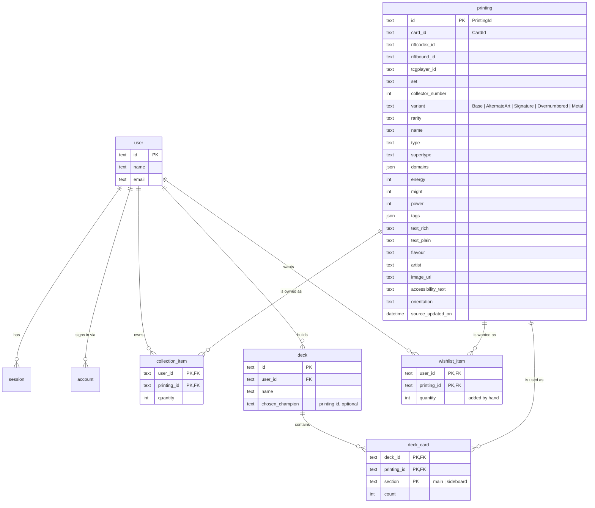
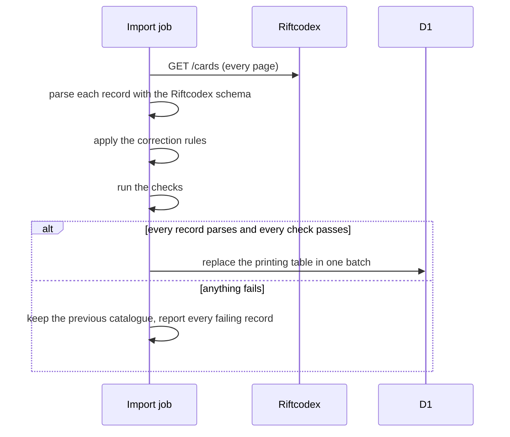
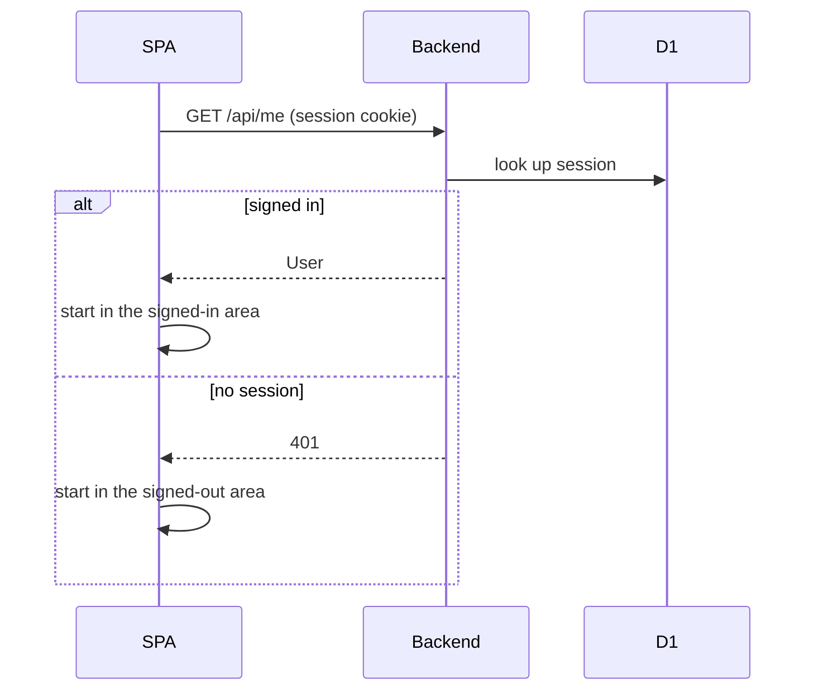
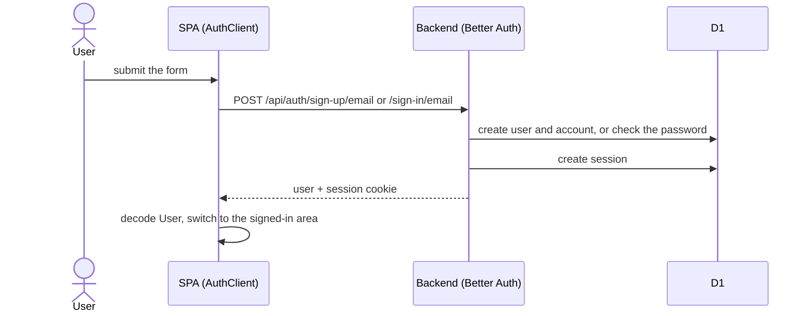
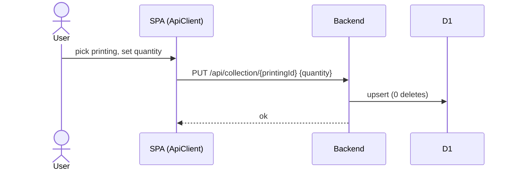
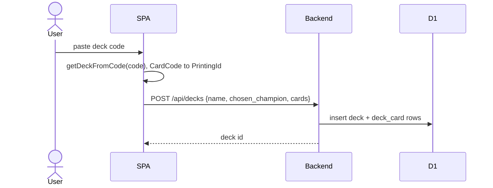
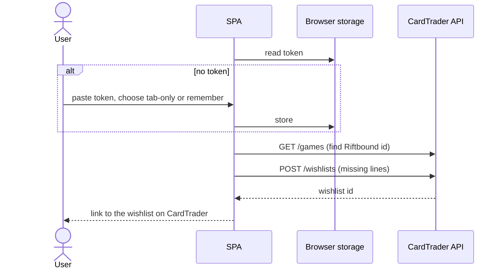

# Data and flows (MVP)

## Card identity

A **printing** is one physical version of a card: normal, alternate art,
signed, overnumbered, metal. Collections and decks are made of printings.
A **card** is the game object; printings of the same card share a `card_id`.

| Id           | Example                | Comes from                                                                                 |
| ------------ | ---------------------- | ------------------------------------------------------------------------------------------ |
| `PrintingId` | `unl-229*-219`         | Riftcodex `riftbound_id` (the official card code), plus `-metal` for Metal printings       |
| `CardId`     | `vi-piltover-enforcer` | Slug of the printing name without its variant suffix (`(Alternate Art)`, `(Signature)`, …) |
| `CardCode`   | `UNL-229*`             | Derived from a `PrintingId` when importing or exporting deck codes; not stored             |

`CardCode` is the [Piltover Archive deck code](https://github.com/Piltover-Archive/RiftboundDeckCodes)
format. It exists only for sets the deck-code library supports, so promo
printings (`OPP`, `PR`, `JDG`) have none.

## Data model (D1)



- `user`, `session`, `account` and `verification` are Better Auth's tables (`src/worker/schema/auth.ts`, generated). Only the relevant columns are shown.
- `printing` exists from Phase 4; `collection_item`, `deck`, `deck_card` and `wishlist_item` arrive in Phases 6 to 8. Their exact columns are decided then.
- Deleting a user cascades to everything they own.

## Catalogue import

A scheduled Backend job (Cloudflare cron), which can also be triggered by hand:



**Correction rules** (pure functions, tested with real Riftcodex records):

- Identical duplicates (equal except Riftcodex's own id and timestamp) become one printing.
- A name ending in `(Metal)` gives variant `Metal` and `-metal` on the id.
- A name ending in `(Alternate Art)` whose id has no `a` gives variant `AlternateArt` and adds the `a`.

**Checks:** every id is unique; the variant agrees with the flags and the name
suffix; set and number agree with `riftbound_id`; every printing has a
`card_id`. Any failure rejects the whole import (all or nothing).

## Missing cards

For each printing:

```
needed  = sum of deck_card.count across all of the user's decks
missing = max(0, needed - collection_item.quantity)
wishlist line = missing + wishlist_item.quantity
```

The deck view groups lines by `card_id` for display; each line stays a
specific printing.

## Flows

### Startup



### Sign up and sign in



### Add an owned printing (Phase 6)



### Import a deck code (Phase 7)



### Send the wishlist to CardTrader (Phases 5 and 8)



## Open questions

1. The body CardTrader expects for `POST /wishlists`: set code and collector number, or its own blueprint ids (Phase 5).
2. Whether CardTrader's Riftbound expansion codes match `OGN`, `UNL`, …, and how it numbers alternate-art, signed and metal printings (Phase 5).
3. How deck codes refer to printings that have no `CardCode` (promos) (Phase 7).
