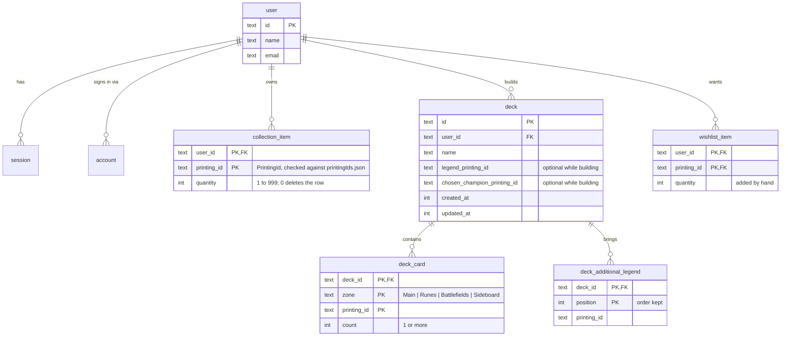
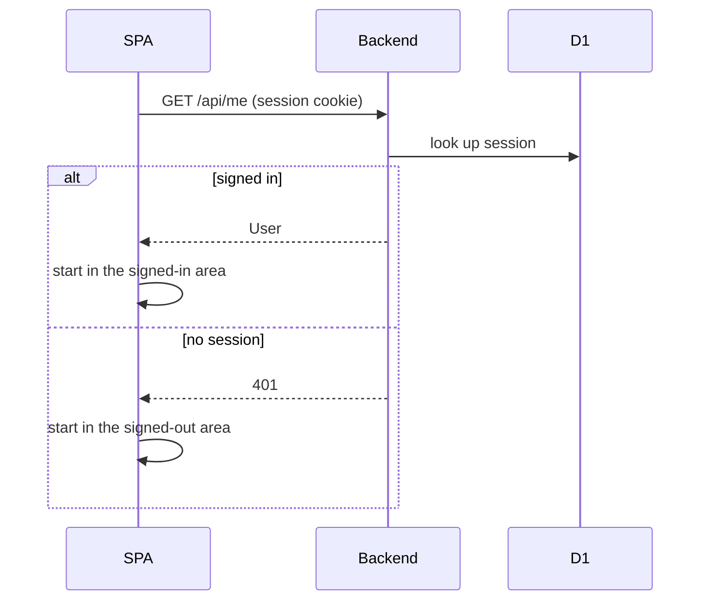
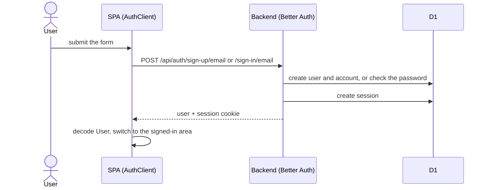
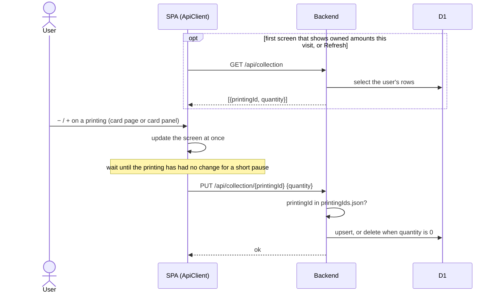
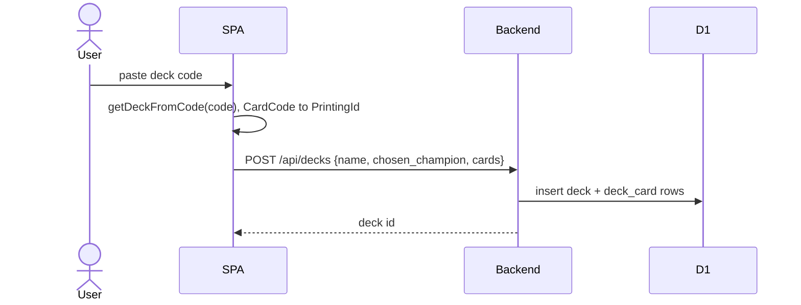
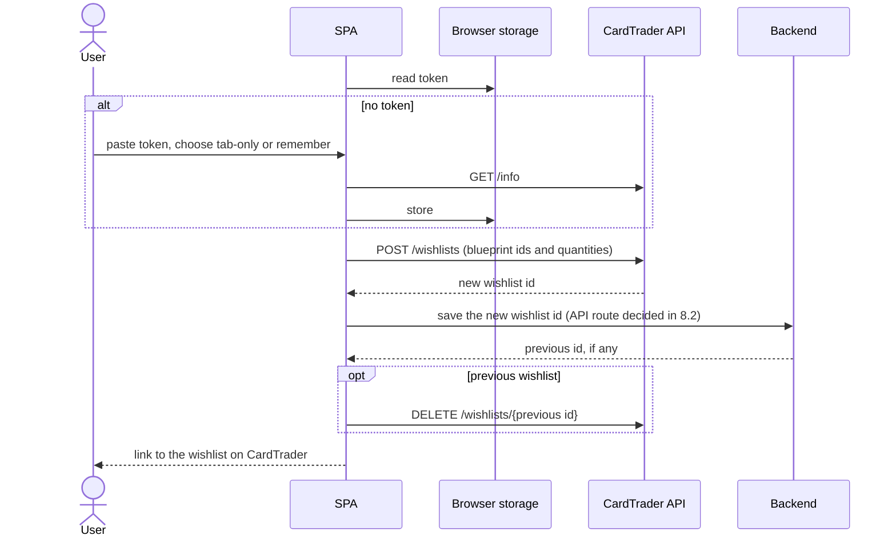

# Data and flows (MVP)

## Card identity

A **printing** is one physical version of a card: normal, alternate art,
signed, overnumbered, metal. Collections and decks are made of printings.
A **card** is the game object; printings of the same card share a `card_id`.

| Id           | Example                | Comes from                                                                     |
| ------------ | ---------------------- | ------------------------------------------------------------------------------ |
| `PrintingId` | `ogn-304-star-298`     | Riot's card id from the Riot API                                               |
| `CardId`     | `vi-piltover-enforcer` | Slug of the card's name and subtitle                                           |
| `CardCode`   | `UNL-229*`             | Derived from a `PrintingId` when importing or exporting deck codes; not stored |

`CardCode` is the [Piltover Archive deck code](https://github.com/Piltover-Archive/RiftboundDeckCodes)
format, derived from a `PrintingId` (`ogn-304-star-298` → `OGN-304*`).

## Data model (D1)



- `user`, `session`, `account` and `verification` are Better Auth's tables (`src/worker/schema/auth.ts`, generated). Only the relevant columns are shown.
- `collection_item`, `deck`, `deck_card` and `wishlist_item` arrive in Phases 6 to 8; their exact columns are decided then. `printing_id` columns hold a `PrintingId` from the catalogue file (not a foreign key); the Backend checks it on every write against `catalogue/printingIds.json`, a list of every `PrintingId` that `catalogue:build` writes next to `catalogue.json`.
- Deleting a user cascades to everything they own, and deleting a deck cascades to its cards and additional legends.

### Decks

A deck is stored part by part, the way the game describes it, not the way a deck code packs it:

| Deck part           | Stored in                                             | In a deck code                                    |
| ------------------- | ----------------------------------------------------- | ------------------------------------------------- |
| Name                | `deck.name`                                           | not carried                                       |
| Legend (1)          | `deck.legend_printing_id`                             | a card inside `mainDeck`                          |
| Chosen champion (1) | `deck.chosen_champion_printing_id`, a copy of its own | `chosenChampion`, plus one copy inside `mainDeck` |
| Main deck           | `deck_card`, zone `Main`                              | `mainDeck`                                        |
| Runes               | `deck_card`, zone `Runes`                             | cards inside `mainDeck`                           |
| Battlefields        | `deck_card`, zone `Battlefields`                      | cards inside `mainDeck`                           |
| Sideboard           | `deck_card`, zone `Sideboard`                         | `sideboard`                                       |
| Additional legends  | `deck_additional_legend`, in order                    | `additionalLegends`, in order                     |

- The chosen champion is never also a `Main` row. Rules that count it (the main deck's minimum, the copy limit) add it in one place, the deck rules check.
- The legend and the chosen champion are optional so a deck can be built step by step. The rules check reports what is missing or wrong; it never blocks saving.
- Importing a code splits `mainDeck` by each card's type in the catalogue. A code that cannot be split, such as one with two starting legends or a champion that is not in its main deck, is rejected with a typed error. Exporting merges the parts back.
- Deck rules come from Riot's [Rules Hub](https://playriftbound.com/en-us/rules-hub/): the Core Rules (section 103, deck construction) and the Tournament Rules for constructed play (402.1: exactly 40 main deck cards with the chosen champion, 1 legend, 12 runes, 3 battlefields with unique names; 601.1.c: a sideboard of 10 or fewer cards, copy limits counted across main deck and sideboard). Both documents were last updated on 9 October 2026. The rules check (`domain/deckRules.ts`) names the rule behind each problem. Format legality (banned cards) is not checked yet.
- Deck codes are read and written with [`@piltoverarchive/riftbound-deck-codes`](https://www.npmjs.com/package/@piltoverarchive/riftbound-deck-codes), wrapped once so its exceptions become typed errors.

## Catalogue build

Card data comes from a swappable `CatalogueSource` service:

| Layer        | Data                                                        | Use                                       |
| ------------ | ----------------------------------------------------------- | ----------------------------------------- |
| Riot gallery | recorded feed pages in `catalogue/recordings/riot-gallery/` | development, now                          |
| Riftcodex    | recorded API pages in `catalogue/recordings/riftcodex/`     | development, later (needs conflict rules) |
| Riot API     | live `riftbound-content-v1` with `RIOT_API_KEY`             | the only source allowed for a public app  |

```mermaid
sequenceDiagram
  participant B as bun run catalogue:build
  participant S as CatalogueSource
  participant A as Vite / Alchemy (dev / deploy)
  B->>S: printings
  S->>S: read the recording, parse every record strictly, map to Printing
  S->>S: run the checks
  alt every record parses and every check passes
    S-->>B: printings
    B->>B: write catalogue/catalogue.json (committed)
  else anything fails
    S-->>B: every failing record
    B->>B: write nothing; the previous catalogue stays
  end
  A->>A: publish catalogue.json as a hashed static asset
```

**Checks:** every record matches the source's schema exactly (unknown fields
are an error); the id parses; set and collector number agree with the id;
every printing has a `card_id`; every id is unique. Any failure rejects the
whole build (all or nothing). A test fails when the committed `catalogue.json` no longer matches the recordings.

## CardTrader

Base URL `https://api.cardtrader.com/api/v2`, `Authorization: Bearer <token>`,
200 requests per 10 seconds across all endpoints (429 above that). The token is
created in the settings page of the user's CardTrader profile and gives full
access to their account, including buying.

**Riftbound on CardTrader:** `game_id` 22. Expansions, recorded in
`catalogue/recordings/cardtrader/`:

| Set   | `expansion_id` |
| ----- | -------------- |
| `ogn` | 4166           |
| `ogs` | 4275           |
| `sfd` | 4299           |
| `unl` | 4425           |
| `ven` | 4521           |
| `rad` | 4522           |

**Blueprints:** one CardTrader blueprint per printing. The catalogue build maps
every printing to its blueprint through `fixed_properties.collector_number`
and stores it as `maybeCardTraderBlueprintId`:

| `PrintingId`       | CardTrader number | Rule                                             |
| ------------------ | ----------------- | ------------------------------------------------ |
| `ogn-066-298`      | `066`             | set and set size dropped                         |
| `ogn-066a-298`     | `066a`            | alternate art keeps `a`                          |
| `ogn-304-star-298` | `304s`            | `-star` becomes `s`                              |
| `ven-r04`          | `R04`             | `r`, `sp`, `t` prefixes upper-cased              |
| `rad-sp1-005`      | `SP1/005`         | CardTrader's `/total` suffix dropped             |
| double-sided       | `T01 // T02`      | each face matches; a single-faced blueprint wins |

A collector number matching more than one blueprint fails the build
(`AmbiguousCardTraderBlueprint`). All 1408 printings currently match.

**Calls the app makes:**

| Call                    | When                                                                                                                    |
| ----------------------- | ----------------------------------------------------------------------------------------------------------------------- |
| `GET /info`             | connecting a token and checking a stored one                                                                            |
| `POST /wishlists`       | sending a wishlist: `game_id` 22, private, one line per printing with `blueprint_id`, `collector_number` and `quantity` |
| `DELETE /wishlists/:id` | after a send, removing the previous wishlist the app made                                                               |

CardTrader has no wishlist update. A send creates the new wishlist first and
then deletes the previous one this app created (its id is kept per user in
D1), so a failed send never leaves the user without one. Edits made on
CardTrader to that wishlist are replaced, and the user is warned. `/info`
responses include `shared_secret`; the client drops it when decoding and they
are never recorded.

**Token:** checked with `GET /info`, then kept in `sessionStorage` or, when
the user chooses "Remember on this device", `localStorage`. It is held as
`Redacted` in the SPA, never sent to the Backend, and cleared on disconnect,
on sign-out, and when CardTrader rejects it.

## Missing cards

For each printing (the exact version a deck uses):

```
uses in a deck = legend + chosen champion + main + runes + battlefields + sideboard + additional legends
needed         = the most copies any one deck uses
missing        = max(0, needed - collection_item.quantity)
wishlist line  = missing + wishlist_item.quantity (added by hand)
```

Cards move between decks, so two decks that each use 3 copies need 3, not 6.
Owning a different printing of the same card does not cover a missing one,
because a deck's printings are chosen on purpose. The calculation is
`domain/missing.ts`.

## Flows

### Startup



### Sign up and sign in



### Add an owned printing (Phase 6)



The collection is loaded once per visit and changed locally; every save sets an
absolute quantity, so a retried request does no harm.

### Import a deck code (Phase 7)



### Send the wishlist to CardTrader (Phases 5 and 8)



## Open questions

1. Where the Riot API publishes the official deckbuilding rules the deck builder must enforce (Phase 7).
2. Whether `riftbound-content-v1` includes promo printings and how it marks variants (4.1, with the development key).
