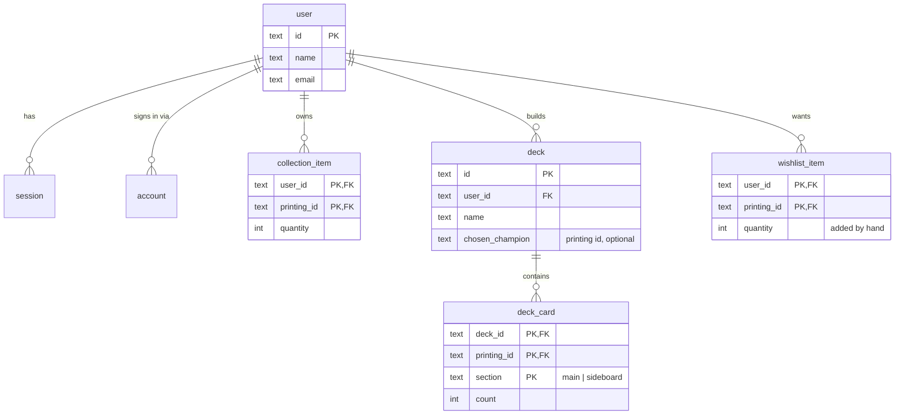
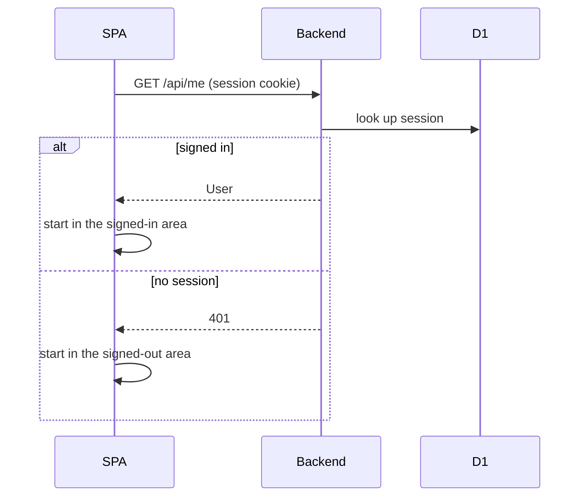
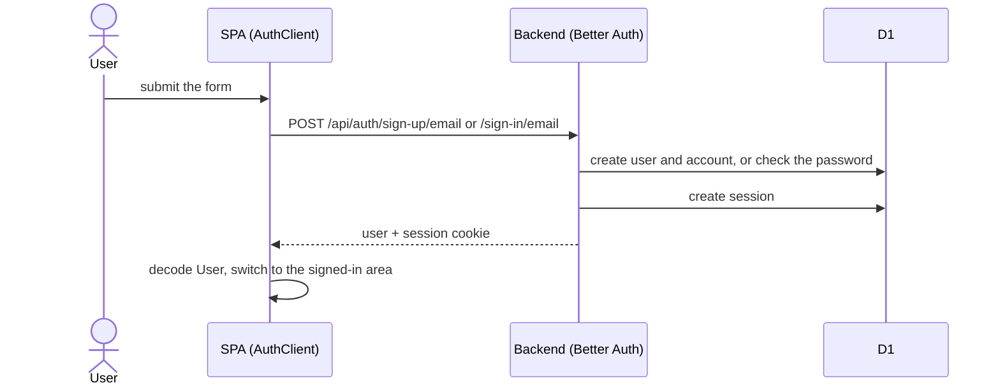
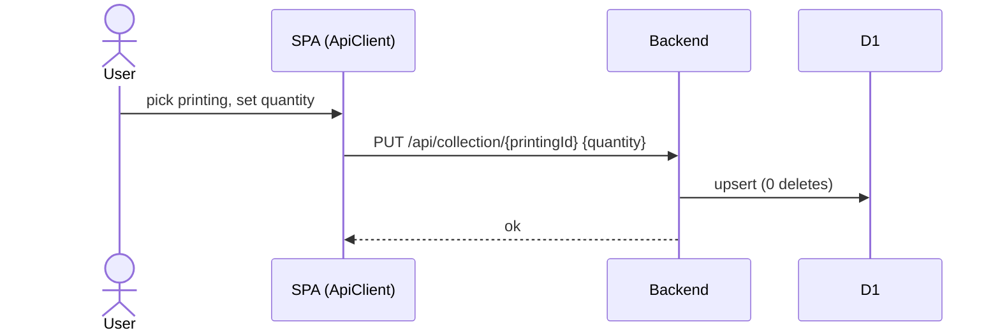
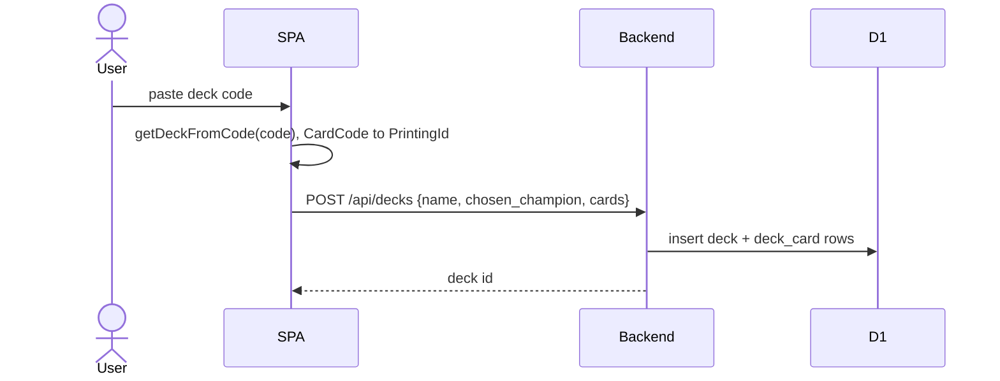
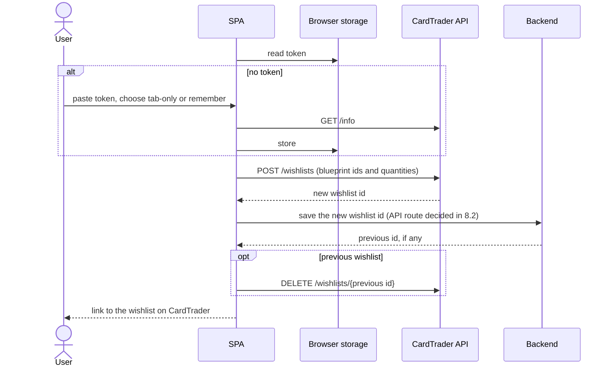

# Data and flows (MVP)

## Card identity

A **printing** is one physical version of a card: normal, alternate art,
signed, overnumbered, metal. Collections and decks are made of printings.
A **card** is the game object; printings of the same card share a `card_id`.

| Id           | Example                | Comes from                                                                     |
| ------------ | ---------------------- | ------------------------------------------------------------------------------ |
| `PrintingId` | `ogn-304-star-298`     | Riot's card id from the Riot API                                               |
| `CardId`     | `vi-piltover-enforcer` | Slug of the card's name and subtitle                                           |
| `CardCode`   | `UNL-229*`             | Derived from a `PrintingId` when importing or exporting deck codes; not stored |

`CardCode` is the [Piltover Archive deck code](https://github.com/Piltover-Archive/RiftboundDeckCodes)
format, derived from a `PrintingId` (`ogn-304-star-298` → `OGN-304*`).

## Data model (D1)



- `user`, `session`, `account` and `verification` are Better Auth's tables (`src/worker/schema/auth.ts`, generated). Only the relevant columns are shown.
- `collection_item`, `deck`, `deck_card` and `wishlist_item` arrive in Phases 6 to 8; their exact columns are decided then. `printing_id` columns hold a `PrintingId` from the catalogue file (not a foreign key); the Backend checks it against the catalogue on every write.
- Deleting a user cascades to everything they own.

## Catalogue build

Card data comes from a swappable `CatalogueSource` service:

| Layer        | Data                                                        | Use                                       |
| ------------ | ----------------------------------------------------------- | ----------------------------------------- |
| Riot gallery | recorded feed pages in `catalogue/recordings/riot-gallery/` | development, now                          |
| Riftcodex    | recorded API pages in `catalogue/recordings/riftcodex/`     | development, later (needs conflict rules) |
| Riot API     | live `riftbound-content-v1` with `RIOT_API_KEY`             | the only source allowed for a public app  |

```mermaid
sequenceDiagram
  participant B as bun run catalogue:build
  participant S as CatalogueSource
  participant A as Vite / Alchemy (dev / deploy)
  B->>S: printings
  S->>S: read the recording, parse every record strictly, map to Printing
  S->>S: run the checks
  alt every record parses and every check passes
    S-->>B: printings
    B->>B: write catalogue/catalogue.json (committed)
  else anything fails
    S-->>B: every failing record
    B->>B: write nothing; the previous catalogue stays
  end
  A->>A: publish catalogue.json as a hashed static asset
```

**Checks:** every record matches the source's schema exactly (unknown fields
are an error); the id parses; set and collector number agree with the id;
every printing has a `card_id`; every id is unique. Any failure rejects the
whole build (all or nothing). A test fails when the committed `catalogue.json` no longer matches the recordings.

## CardTrader

Base URL `https://api.cardtrader.com/api/v2`, `Authorization: Bearer <token>`,
200 requests per 10 seconds across all endpoints (429 above that). The token is
created in the settings page of the user's CardTrader profile and gives full
access to their account, including buying.

**Riftbound on CardTrader:** `game_id` 22. Expansions, recorded in
`catalogue/recordings/cardtrader/`:

| Set   | `expansion_id` |
| ----- | -------------- |
| `ogn` | 4166           |
| `ogs` | 4275           |
| `sfd` | 4299           |
| `unl` | 4425           |
| `ven` | 4521           |
| `rad` | 4522           |

**Blueprints:** one CardTrader blueprint per printing. The catalogue build maps
every printing to its blueprint through `fixed_properties.collector_number`
and stores it as `maybeCardTraderBlueprintId`:

| `PrintingId`       | CardTrader number | Rule                                             |
| ------------------ | ----------------- | ------------------------------------------------ |
| `ogn-066-298`      | `066`             | set and set size dropped                         |
| `ogn-066a-298`     | `066a`            | alternate art keeps `a`                          |
| `ogn-304-star-298` | `304s`            | `-star` becomes `s`                              |
| `ven-r04`          | `R04`             | `r`, `sp`, `t` prefixes upper-cased              |
| `rad-sp1-005`      | `SP1/005`         | CardTrader's `/total` suffix dropped             |
| double-sided       | `T01 // T02`      | each face matches; a single-faced blueprint wins |

A collector number matching more than one blueprint fails the build
(`AmbiguousCardTraderBlueprint`). All 1408 printings currently match.

**Calls the app makes:**

| Call                    | When                                                             |
| ----------------------- | ---------------------------------------------------------------- |
| `GET /info`             | connecting a token and checking a stored one                     |
| `POST /wishlists`       | sending a wishlist: `game_id` 22, private, one line per printing |
| `DELETE /wishlists/:id` | after a send, removing the previous wishlist the app made        |

CardTrader has no wishlist update. A send creates the new wishlist first and
then deletes the previous one this app created (its id is kept per user in
D1), so a failed send never leaves the user without one. Edits made on
CardTrader to that wishlist are replaced, and the user is warned. `/info`
responses include `shared_secret`; the client drops it when decoding and they
are never recorded.

**Token:** checked with `GET /info`, then kept in `sessionStorage` or, when
the user chooses "Remember on this device", `localStorage`. It is held as
`Redacted` in the SPA, never sent to the Backend, and cleared on disconnect,
on sign-out, and when CardTrader rejects it.

## Missing cards

For each printing:

```
needed  = sum of deck_card.count across all of the user's decks
missing = max(0, needed - collection_item.quantity)
wishlist line = missing + wishlist_item.quantity
```

The deck view groups lines by `card_id` for display; each line stays a
specific printing.

## Flows

### Startup



### Sign up and sign in



### Add an owned printing (Phase 6)



### Import a deck code (Phase 7)



### Send the wishlist to CardTrader (Phases 5 and 8)



## Open questions

1. Whether a `POST /wishlists` line with only `blueprint_id` pins the exact printing. CardTrader documents it as "a shortcut to set the meta_name and the expansion_code", which may match any printing of the card in that set; if so, lines also send `collector_number` (8.2, checked with one recorded call).
2. Where the Riot API publishes the official deckbuilding rules the deck builder must enforce (Phase 7).
3. Whether `riftbound-content-v1` includes promo printings and how it marks variants (4.1, with the development key).
